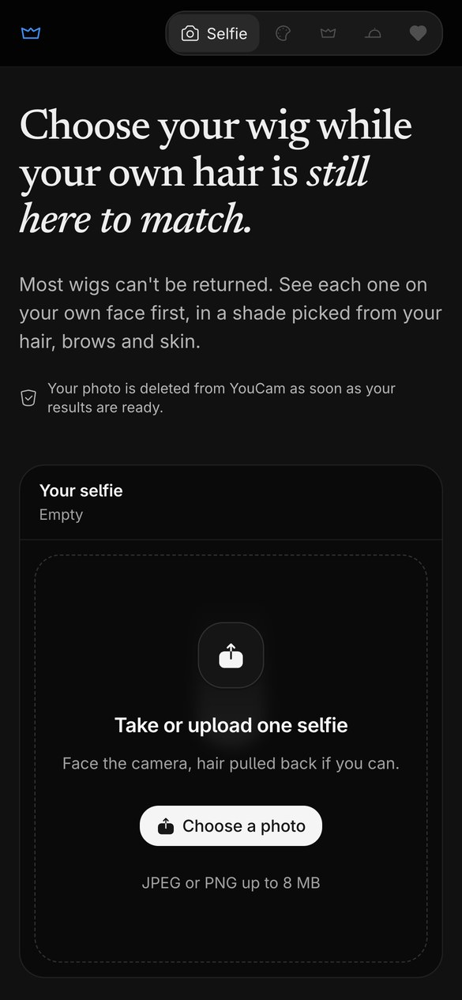
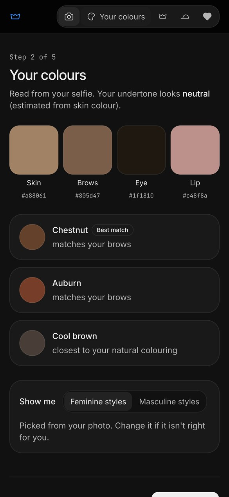
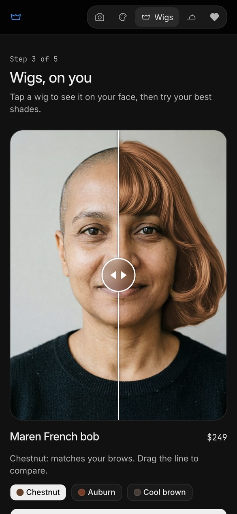
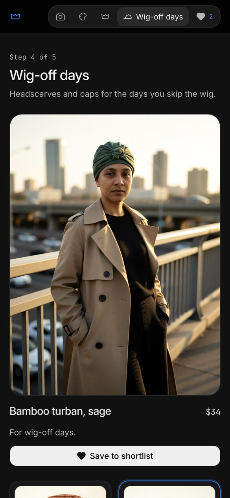
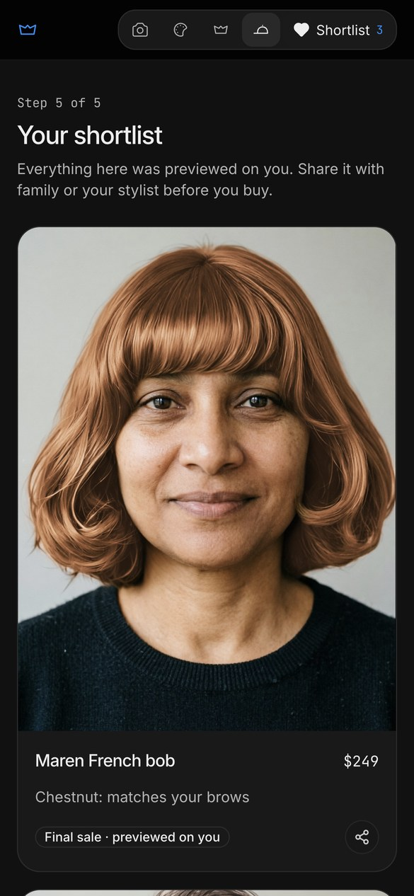

# Crown

**See the wig on you before you buy.** Crown lets someone starting chemotherapy try wigs, headscarves and caps on their own face, from one selfie, before spending money on something they usually can't return.

- Live app: LIVE_URL
- Demo video (2:24): https://youtu.be/XwVJW7QMd6s
- Built for the YouCam API Skin AI & eCommerce VTO Hackathon, eCommerce VTO track

| Selfie | Your colours | Wigs, on you | Wig-off days | Shortlist |
|---|---|---|---|---|
|  |  |  |  |  |

## The problem

People are told to choose a wig before hair loss starts. Wigs cost hundreds to thousands of dollars and are usually final sale for hygiene reasons, and the choice is made in the weeks after a diagnosis. Today that means guessing from a mannequin photo or travelling to a fitting.

## How it works

1. **Selfie.** YouCam skin-tone analysis reads skin, brow, eye and lip colour; face-attribute analysis pre-selects feminine or masculine styles (the person can change it).
2. **Your colours.** Three wig shades ranked by closeness to the brows (CIEDE2000) and the estimated undertone, each with its reason.
3. **Wigs, on you.** 16 wigs (8 feminine, 8 masculine, including afro, locs and a silver taper) are YouCam hair-transfer templates placed on the person's own face, with a before/after slider. Shade chips recolour the result with YouCam hair-color.
4. **Wig-off days.** Turbans, wraps and caps tried on with the YouCam hat task (6 per style set).
5. **Shortlist.** Saved looks with price, the reason they were picked and a "Final sale · previewed on you" badge, shared through the phone's share sheet or saved as an image.

Try **"Or try it with our demo photo"** to see the whole flow from cached results, with no API units spent.

## YouCam APIs used

| API | Used for | Units (measured) |
|---|---|---|
| `v2.0/task/skin-tone-analysis` | skin, brow, eye and lip colour | 20 per selfie |
| `v2.0/task/face-attr-analysis` (`gender`) | pre-selects the style set | 10 per selfie |
| `v2.1/task/hair-transfer` (templates) | the wig on the person's face | 2 per wig |
| `v2.0/task/hair-color` (hex palettes) | the recommended shade on that wig | 1 per shade |
| `v2.0/task/hat` | headscarves, turbans and caps | 2 per item |
| `v2.0/task/text-to-image/youcam` | the brand-free product photos and the demo persona | 1 per image |
| `v2.0/file`, `v2.0/task/delete`, `v1.0/client/credit` | upload, privacy delete, budget guard | 0 |

Notes from building it:
- The `scarf` task wraps the neck, so all head coverings use the `hat` task.
- `hair-color` needs `pattern: {name: "full"}` alongside `palettes`.
- `skin-tone-analysis` returned no `hair_color` for people with hair and "Auburn" for a shaved head, so Crown ranks shades by brows instead.

## Privacy and budget

- Every task is deleted from YouCam (`task/delete`) as soon as its result is saved.
- Results are cached by a hash of the photo plus the product and shade, so a look is never paid for twice, even when two requests race.
- Live calls stop when the account drops below 150 units; the cached demo keeps working.
- The API key stays on the server. Uploads are checked at the boundary: real JPEG/PNG by magic bytes, under 8 MB.

## Run it

```bash
npm install
cp .env.example .env   # add YOUCAM_API_KEY
npm run dev            # http://localhost:3000
npm test               # 12 tests: validator, poller, cache, shade picks, route validation
```

Regenerate the demo results (dev server running): `node --import tsx scripts/demo.mts`. Regenerate the product photos: `node --env-file=.env --import tsx scripts/products.mts`.

## Stack

Next.js 15 (App Router) with three API routes, React 19, Tailwind v4, shadcn/ui (Base UI), Spectrum UI (Drop Files, empty state, Share Button), react-compare-slider, culori, file-type, sonner, Iconoir. The dark theme follows the Interfere design system. The demo video was made with HyperFrames (`video/`).

## About the demo persona

"Asha" is not a real person: she was generated with YouCam text-to-image. Every try-on in the app and the video is a real YouCam result.

## Licence

MIT
